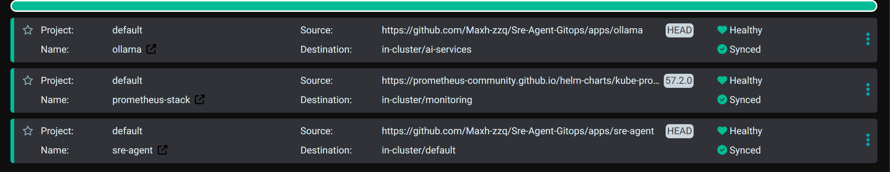
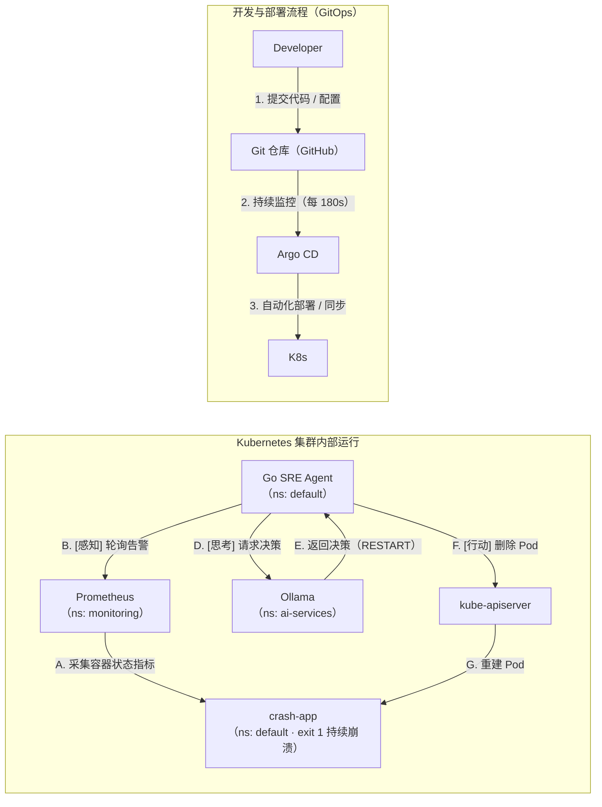

# K8s SRE Agent · 基于本地 LLM 的 Pod 故障自愈闭环

> 一个**反应式**的自愈闭环：Pod 进入 `CrashLoopBackOff` 时，让本地大模型判断「这次该不该重启」，该重启就删掉 Pod、交给 ReplicaSet 重建。
>
> **范围只有这一种故障，但链路是端到端的** —— 从容器状态指标、告警规则、模型判断、API 调用到控制器重建，每一跳都在真实集群上跑，不是示意图。



```
Prometheus 告警  ──▶  Agent 主动拉取  ──▶  qwen2.5:1.5b 判断  ──▶  DELETE Pod  ──▶  ReplicaSet 重建
   （感知）              （每 30 秒）           （3~5 秒）            （行动）          （自愈）
```

### 它和「`kubectl delete pod` + 一个 if」的区别

三条，按重要性递增：

1. **它自己会持续盯着**，不用人值守 —— 每 30 秒拉一次告警，命中就处理，处理完继续下一轮。
2. **判定不是布尔值**，是把告警 + Pod 名字交给模型，让它给出「重启 / 不处理」的判断；判断依据可以随着上下文增加而扩展。
3. **它有权限边界**：ServiceAccount 只被授予 `delete pods`（见 `apps/sre-agent/rbac.yaml`），碰不到节点、容器、其他资源——**判断力可以慢慢加，破坏力从一开始就是锁死的**。

---

## 它做什么

| | |
|---|---|
| **触发** | Prometheus 规则 `PodCrashLooping`（`for: 1m`）进入 firing |
| **输入** | 告警里的一行 `description`：Pod 名 + 命名空间 |
| **判断** | `POST /api/generate` 给本地 Ollama，问「该不该重启」 |
| **动作** | 模型回复判断是否该重启（当前是关键词匹配，见已知问题 3）→ 该重启就 `DELETE` 该 Pod |
| **重建** | 由 ReplicaSet 完成，Agent 不碰节点、不碰容器 |

### 它不做什么

| ❌ | 原因 |
|---|---|
| 不主动巡检 | 没有自己的指标采集，只等告警 |
| 不处理其他故障（OOM、镜像拉不到、Pending…） | 只认一个 `alertname`，这是已知缺陷 |
| 不"修复"根因 | 它做的是**重置**（重建 Pod），根因是配置错时重启一万次也没用 |
| 不做决策记录与审计 | 无状态，每轮从头开始 |
| 没有冷却时间与次数上限 | 有 RBAC 兜底（只能删 Pod），但同一个 Pod 会被连续删 2~3 次，见已知问题 1 |

---

## 为什么只做 `CrashLoopBackOff` 这一种

因为它是**固定规则最不管用的那一种**。

`CrashLoopBackOff` 有两种完全相反的成因：

| 成因 | 重启有用吗 |
|---|---|
| 偶发 OOM、依赖抖动、节点瞬时压力 | ✅ 重启就好 |
| 配置写错、镜像 tag 不存在、入口命令错 | ❌ 重启一万次也好不了，只会变成**自愈风暴** |

固定规则只有一条「崩了就重启」，**分不出这两者**。所以这一种故障恰恰需要「判断」这一环——**把范围收窄到这一条，是为了让判断有意义，不是为了省事。**

> 更准确的自我定位：它是一个**只会处理一种告警的值班实习生**——能自己跑 24 小时，但判断力有限，而且权限上只允许删 Pod。

---

## 架构



### 四条链

| 链 | 路径 | 一句话 |
|---|---|---|
| **部署链** | GitHub → Argo CD（180s 轮询）→ `kubectl apply` | Git 是唯一变更入口 |
| **监控链** | crash-app → kube-state-metrics → Prometheus（`for: 1m`）→ `ALERTS` 指标 | 指标不来自 kubelet，来自 KSM |
| **决策链** | Prometheus → Agent（**主动 GET**）→ Ollama | 是 Agent 去拉，不是 Prometheus 推 |
| **执行链** | Agent → kube-apiserver（DELETE）→ ReplicaSet 重建 | Agent 只删 Pod 对象 |

> 两个容易画错的地方：**B 的方向**（Agent → Prometheus，不是反过来），以及 **G 的执行者**（重建是 ReplicaSet 干的，不是 Agent）。

---

## 实测数据

全部在 3 台 VMware 虚拟机（3.6 GB 内存 / 无 GPU）上实测：

| 指标 | 实测值 |
|---|---|
| 一轮闭环延迟 | **1.5 ~ 4 分钟**（其中 `for: 1m` 独占 60 秒，其余是 scrape + eval 的观测链延迟） |
| LLM 单次推理 | **3 ~ 5 秒**（`qwen2.5:1.5b` · CPU · 986 MB 权重） |
| Agent 轮询周期 | **30 ~ 36 秒** |
| 告警总量 vs 业务告警 | **15 条总量（firing 11 / pending 4），其中业务告警只有 1 条**——其余是单 master 环境的控制面噪音 |
| 删除调用有效率 | **23 次调用中 6 次返回 404 = 26% 无效**（告警是快照、动作是异步，见「已知问题」） |

---

## 目录结构

```
.
├─ README.md
├─ docs/
│  └─ argo.png                   # Argo CD 三个 Application 全绿
├─ apps/                        # Argo CD 管理的声明式期望状态
│  ├─ ollama/
│  │  └─ ollama.yml             # Namespace + PVC + Deployment + Service（单文件多文档）
│  └─ sre-agent/
│     ├─ deployment.yaml
│     └─ rbac.yaml              # SA + ClusterRole + ClusterRoleBinding
└─ src/                         # Go 源码
   ├─ main.go                   # 266 行：8 个函数，其中 4 个在调用路径上
   ├─ go.mod
   ├─ go.sum
   └─ Dockerfile                # 多阶段构建，CGO_ENABLED=0
```

**注意**：`apps/ollama` 里把 PVC 和 Deployment 放在同一个文件，是因为它们的生命周期不同——部署时可以一起 apply，但**删除时不能一起删**（`kubectl delete -f` 会连 PVC 一起带走，`reclaimPolicy: Delete` 下数据当场消失）。生产上应该只把 PVC 拆出去。

---

## 快速开始

**前置**：一个可用的 K8s 集群（本项目用 kubeadm + 3 台 Rocky 9，1 master 2 worker）。

下面这套流程默认**用 Argo CD 接管 `apps/`**——这样 `selfHeal` 才有意义。不想装 Argo 的话，把第 4 步换成 `kubectl apply -f apps/sre-agent/rbac.yaml -f apps/sre-agent/deployment.yaml` 也能跑，只是失去了 GitOps。

```bash
# 1) 部署 Ollama（Namespace + PVC + Deployment + Service 都在一个文件里）
kubectl apply -f apps/ollama/ollama.yml

# 2) 拉一次模型（权重落在 PVC 上，Pod 重启不丢）
POD=$(kubectl -n ai-services get pod -l app=ollama -o jsonpath='{.items[0].metadata.name}')
kubectl -n ai-services exec -it "$POD" -- ollama pull qwen2.5:1.5b

# 3) 构建 Agent 镜像并分发到所有节点（无镜像仓库，走本地导入）
docker build -t sre-agent:v1.0 -f src/Dockerfile src/
docker save sre-agent:v1.0 -o /tmp/sre-agent-v1.0.tar
for node in k8s-node1 k8s-node2 k8s-node3; do
  scp /tmp/sre-agent-v1.0.tar "$node":/tmp/ && \
  ssh "$node" "ctr -n k8s.io image import /tmp/sre-agent-v1.0.tar"
done
# 注意：kubelet 只看 k8s.io 这个 namespace，docker build 的产物在 moby 里，必须 import

# 4) 手工建一次 Application（bootstrap，见下），之后 rbac.yaml / deployment.yaml 由 Argo 接管
kubectl apply -f /tmp/sre-agent-app.yaml

# 5) 造一个持续崩溃的故障源
#    必须是 Deployment —— 裸 Pod 删掉之后没有控制器重建，闭环只能演示一遍
kubectl create deployment crash-app --image=alpine:3.20 -- /bin/sh -c "echo failing; exit 1"

# 6) 观察闭环
kubectl -n default logs -f deploy/sre-agent
```

预期日志（`for: 1m` + 观测链延迟，第一次大概要等 1.5~4 分钟）：

```
--- Agent Loop Start ---
Found 12 active alert(s).
Handling PodCrashLooping alert for default/crash-app-xxxxx
DEBUG: Raw LLM response: 'Given that the pod is in CrashLoopBackOff...'
LLM Decision: RESTART
Deleting pod default/crash-app-xxxxx to trigger restart...
```

<details>
<summary><b>Application 对象（bootstrap，不在本仓库）</b></summary>

Argo CD 不能管理自己——**根 Application 必须手工创建一次**。这是 GitOps 的经典鸡生蛋问题。

```yaml
apiVersion: argoproj.io/v1alpha1
kind: Application
metadata:
  name: sre-agent
  namespace: argocd
spec:
  project: default
  source:
    repoURL: 'https://github.com/Maxh-zzq/Sre-Agent-Gitops'
    targetRevision: HEAD
    path: apps/sre-agent
  destination:
    server: 'https://kubernetes.default.svc'
    namespace: default
  syncPolicy:
    automated: { prune: true, selfHeal: true }
    syncOptions: ["CreateNamespace=true"]
```

生产做法是 **App-of-Apps**（把 Application 清单本身也放进 Git）或 **ApplicationSet**（多集群多环境）。
</details>

---

## 已知问题

这一节比上面所有内容都重要——**它说明我知道这东西离生产还差什么**。

| # | 问题 | 现象 | 正确做法 | 差距 |
|---|---|---|---|---|
| 1 | **无状态** | 同一条告警连续几个循环里删同一个 Pod 2~3 次，永不收敛 | `lastAction` 5 分钟限流 + 工作负载级重启计数，3 次后升级给人 | ~20 行 |
| 2 | **判断依据太少** | 只喂一行告警描述，模型分不清「配置错」和「偶发 OOM」 | 恢复 `getPodContext()`（现存死代码，读日志/Events）并控制上下文长度 | ~46 行 |
| 3 | **动作判定靠字符串匹配** | 「You should **not** restart」会被读成 RESTART | 让模型输出结构化 JSON，解析字段而非关键词 | ~15 行 |
| 4 | **只认一个 alertname** | 故障形态从 `CrashLoopBackOff` 变成 `ImagePullBackOff`，Agent 完全看不见（曾空转 1.5 小时） | 按 `waiting.reason` 分类处理 | ~30 行 |
| 5 | **访问方式反模式** | Agent 用 `Node IP + NodePort` 硬编码访问 Prometheus / Ollama；Service 重建后端口漂移就断 | ClusterIP + 服务名 | 改 2 行 |
| 6 | **权限过大** | 只处理 `default`，却给了 `ClusterRole`（全集群删 Pod） | 改 `Role` + `RoleBinding`，verbs 只留 `delete` | 改 YAML |
| 7 | **绕过 Alertmanager** | 直接读 `/api/v1/alerts`，丢掉分组/抑制/静默/去重（这正是问题 1 的成因之一） | Alertmanager 配 webhook 推给 Agent | 架构级 |
| 8 | **无资源限制与探针** | Ollama 与 Agent 都没有 `resources` / `readinessProbe` | 补 `requests`（修调度失真）+ `readinessProbe`（避免 Agent 打到未就绪的 Ollama） | 改 YAML |
| 9 | **判断准确率从没测过** | 观察到 12 次决策全部是 `RESTART`，`IGNORE` 一次没出现（部分原因是问题 3 的字符串匹配） | 造一批「不该重启」的对照场景（配置错、镜像 tag 错）测误判率 | 需新场景 |

> **错判的后果有多大？** Agent 只会删 Pod，最坏情况是让一个本来就崩的 Pod 再重建一次——不会丢数据、不会动节点、不会改配置、不会影响别的 Pod。**这是它敢用 1.5B 模型的前提：判断力靠模型，破坏力靠权限边界框住。**

---

## 三条踩过的坑

### ① `volumeMounts` 缩进多了一个空格 → 永远 `OutOfSync`，且不报错

Argo 显示 `Synced` 成功、Pod 正常运行，但状态永远 `OutOfSync`。

根因：`volumeMounts:` 比 `ports:` 多缩进一个空格，被并进了 `containerPort` 列表项。K8s 认 `ContainerPort` 只有 5 个合法字段，多出来的被**静默丢弃**——**不报警、不拒绝，只是不生效**。

排查靠 `App Diff` 一栏一栏比。教训：**`apply` 成功 ≠ 配置生效**。

### ② `kubectl apply` 对多文档文件没有事务性 → 一个控制器崩了 29 天

`kubectl apply -f install.yaml`（3 个 CRD + 6 个 Deployment）时，其中一份 CRD 有 4 MB，超过 `last-applied-configuration` 注解 256 KiB 上限，报错被刷过，**只跳过了那一个对象**。

结果：其余 8 个对象正常，`applicationset-controller` 从第一秒就在找不存在的 CRD，每 10 秒崩一次，崩了 29 天。因为**那个控制器不服务我实际使用的功能，集群一直是绿的**。

修复：`kubectl apply --server-side --force-conflicts`。

### ③ 告警是快照，动作是异步 → 26% 的删除调用打在已消失的 Pod 上

日志里会看到 `pods "xxx" not found`。

不是 bug，是**动作迟到**：从 Pod 被删到告警消失，要等 KSM 清 series（≤30s）+ Prometheus 下一次评估（≤30s），中间最多 60 秒；而 Agent 每 30 秒轮询一次，必然撞上这个窗口。

关键认知：**「目标已达成」和「操作返回成功」是两件事** —— 这个 Pod 不存在，正说明我想做的事已经完成了，`NotFound` 应该当成功处理。

---

## 技术栈

| 层 | 选型 |
|---|---|
| 集群 | kubeadm · Kubernetes **v1.32.13** · 1 master + 2 worker · Rocky Linux 9.6 |
| 容器运行时 | containerd 2.4.1（`SystemdCgroup = true`） |
| 网络 | Calico v3.27.3 · Pod CIDR `10.244.0.0/16` |
| 集群部署 | Ansible（`ansible-core` + `ansible.posix` + `community.general`，幂等 playbook） |
| GitOps | Argo CD **v3.5.4** |
| 可观测 | kube-prometheus-stack **57.2.0** · 38 条规则（**自建 1 条** `PodCrashLooping`，其余 37 条 chart 自带）· Grafana · Alertmanager（未配 receiver） |
| 推理 | Ollama + `qwen2.5:1.5b`（986 MB，CPU 推理） |
| Agent | Go 1.22 · `client-go`（官方 SDK；单文件二进制便于塞进 69 MB 镜像）· 单文件 266 行 |
